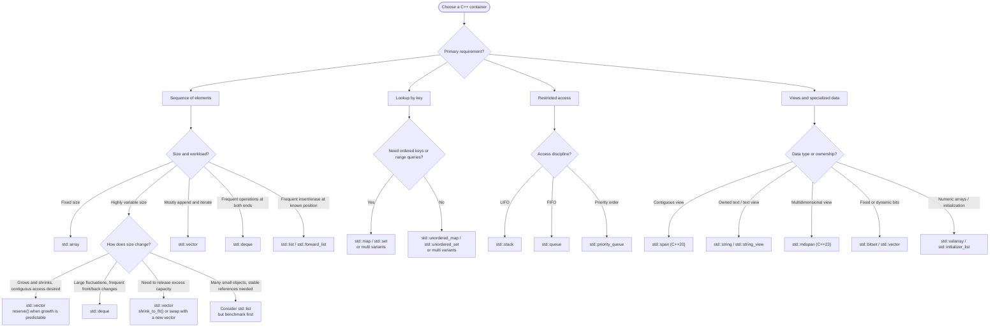

# C++ containers

## Table of contents

- [Introduction](#introduction)
- [Container overview](#container-overview)
- [Sequence containers](#sequence-containers)
- [Associative containers](#associative-containers)
    - [Ordered associative containers](#ordered-associative-containers)
    - [Unordered associative containers](#unordered-associative-containers)
- [Container adaptors](#container-adaptors)
- [Almost containers](#almost-containers)

## Introduction

In C++, a **container** is an object that stores and organizes a collection of objects. The C++ Standard Library provides several containers, each designed for different access, insertion, deletion, and memory-management requirements.

Choosing the right container can have a significant impact on a program:

- **Performance**: different containers have different time complexities.
- **Memory usage**: some containers store elements contiguously, while others use linked structures, trees, or hash tables.
- **Ease of use**: the appropriate container can make code simpler and safer.
- **Data organization**: containers can represent sequences, sets, key-value relationships, queues, and other common data structures.

Most standard containers can be used with **iterators** and the algorithms provided by the C++ Standard Library.

The most appropriate container depends on the operations that the program performs. For example, a container optimized for random access may not be the best choice when elements are frequently inserted or removed.

## Container overview

Containers can be categorized as follows:

- **Sequence containers**: provide access to sequence of elements.
- **Associative containers**: provide associative lookup based on a key. They are divided into:
    - **Ordered associative containers**: elements are kept sorted.
    - **Unordered associative containers**: elements are organized using hashing.
- **Container adaptors**: provide specialized access to underlying containers.
- **Almost containers**: sequences of elements that provide most, but not all, of the facilities of a container.

## Sequence containers

### `std::vector`

`std::vector` is a dynamically sized sequence with contiguous storage. It is usually the **default choice for a general-purpose collection**.

```c++
#include <vector>

std::vector<int> numbers{10, 20, 30};
numbers.push_back(40);
```

**Use it when:** you need a dynamic sequence, especially when random access is important.

### `std::list`

`std::list` is a doubly linked list.

```c++
#include <list>

std::list<int> numbers{10, 20, 30};
numbers.push_front(5);
```

**Use it when:** you need efficient insertion or removal at known positions.

### `std::forward_list`

`std::forward_list` is a singly linked list. It can only be traversed forward.

```c++
#include <forward_list>

std::forward_list<int> numbers{10, 20, 30};
numbers.push_front(5);
```

**Use it when:** you need a lightweight linked list with forward-only traversal.

### `std::deque`

`std::deque` is a double-ended sequence container. It provides efficient insertion and removal at both ends and supports random access.

```c++
#include <deque>

std::deque<int> numbers{20, 30};
numbers.push_front(10);
numbers.push_back(40);
```

**Use it when:** you frequently add or remove elements from both ends.

## Associative containers

### Ordered associative containers

#### `std::map`

`std::map` stores key-value pairs with unique keys. Keys are kept sorted.

```c++
#include <map>
#include <string>

std::map<std::string, int> ages{
    {"Alice", 25},
    {"Bob", 30}
};
```

**Use it when:** you need key-value data with sorted keys.

#### `std::multimap`

`std::multimap` is like `std::map`, but allows multiple elements with the same key.

```c++
#include <map>
#include <string>

std::multimap<std::string, int> scores;
scores.emplace("Alice", 90);
scores.emplace("Alice", 95);
```

**Use it when:** multiple values can have the same key and sorted keys are required.

#### `std::set`

`std::set` stores unique values in sorted order.

```c++
#include <set>

std::set<int> numbers{30, 10, 20, 20};
numbers.insert(40);
```

The set contains:

```text
10 20 30 40
```

**Use it when:** you need unique values and sorted order.

#### `std::multiset`

`std::multiset` is like `std::set`, but allows duplicates.

```c++
#include <set>

std::multiset<int> numbers{10, 20, 20};
numbers.insert(20);
```

**Use it when:** you need sorted values and duplicates are allowed.

### Unordered associative containers

#### `std::unordered_map`

`std::unordered_map` is like `std::map`, but uses hashing instead of maintaining sorted order.

```c++
#include <unordered_map>
#include <string>

std::unordered_map<std::string, int> ages{
    {"Alice", 25},
    {"Bob", 30}
};
```

**Use it when:** you need fast average-case lookup by key and ordering is not important.

#### `std::unordered_multimap`

`std::unordered_multimap` is like `std::multimap`, but uses hashing instead of maintaining sorted order.

```c++
#include <unordered_map>
#include <string>

std::unordered_multimap<std::string, int> scores;
scores.emplace("Alice", 90);
scores.emplace("Alice", 95);
```

**Use it when:** multiple values can have the same key and ordering is not important.

#### `std::unordered_set`

`std::unordered_set` is like `std::set`, but uses hashing instead of maintaining sorted order.

```c++
#include <unordered_set>

std::unordered_set<int> numbers{10, 20, 30};
numbers.insert(40);
```

**Use it when:** you need fast average-case membership lookup and do not need sorted values.

#### `std::unordered_multiset`

`std::unordered_multiset` is like `std::multiset`, but uses hashing instead of maintaining sorted order.

```c++
#include <unordered_set>

std::unordered_multiset<int> numbers{10, 20, 20};
numbers.insert(20);
```

**Use it when:** you need hashed lookup and duplicate values are allowed.

## Container adaptors

### `std::queue`

`std::queue` is an interface to a container that follows **FIFO**: First In, First Out.

```c++
#include <queue>

std::queue<int> values;
values.push(10);
values.push(20);
values.pop(); // Removes 10.
```

**Use it when:** elements should be processed in the order they were added.

### `std::priority_queue`

`std::priority_queue` is a queue in which each element is given a priority, that controls the order of the elements in the queue.

```c++
#include <queue>

std::priority_queue<int> values;
values.push(10);
values.push(30);
values.push(20);
values.pop(); // Removes 30.
```

**Use it when:** elements need to be processed according to priority.

### `std::stack`

`std::stack` is an interface to a container that follows **LIFO**: Last In, First Out.

```c++
#include <stack>

std::stack<int> values;
values.push(10);
values.push(20);
values.pop(); // Removes 20.
```

**Use it when:** the last element added should be the first one removed.

## Almost containers

### Built-in array

`T[N]` is a fixed size built-in array, with `N` contiguous elements of type `T`. Built-in arrays are a fundamental C++ language feature.

```c++
int numbers[3] = {10, 20, 30};
numbers[0] = 15;
```

**Use it when:** interacting with low-level code, C APIs, or when a simple built-in array is specifically required.

**Note:** for most modern C++ code, prefer `std::array` when the size is fixed, or `std::vector` when the size is dynamic. They provide a safer and more convenient interface and work naturally with the C++ Standard Library.

### `std::array`

`std::array` is a fixed-size array of `N` contiguous elements of type `T`.

```c++
#include <array>

std::array<int, 3> numbers{10, 20, 30};
```

**Use it when:** the number of elements is known at compile time.

### `std::valarray`

`std::valarray` is designed for numerical operations on arrays of values.

```c++
#include <valarray>

std::valarray<double> values{1.0, 2.0, 3.0};
values *= 2.0;
```

**Use it when:** its specialized numerical operations fit the problem, and you do a lot of vector arithmetic.

### `std::string`

`std::string` represents a sequence of characters and provides operations specifically for text. It is typically optimized not to require free store for short strings.

```c++
#include <string>

std::string name{"Bjarne"};
name += " Stroustrup";
```

**Use it when:** working with text.

### `std::bitset`

`std::bitset` stores a fixed number of bits.

```c++
#include <bitset>

std::bitset<8> flags{"00000001"};
flags |= 0b10000000;
```

**Use it when:** you need a fixed-size collection of bits.

### `std::vector<bool>`

`std::vector<bool>` is a specialized version of `std::vector` that stores boolean values compactly.

```c++
#include <vector>

std::vector<bool> flags(8);
flags[2] = true;
```

**Use it when:** compact storage of boolean values is useful.

## Container selection


